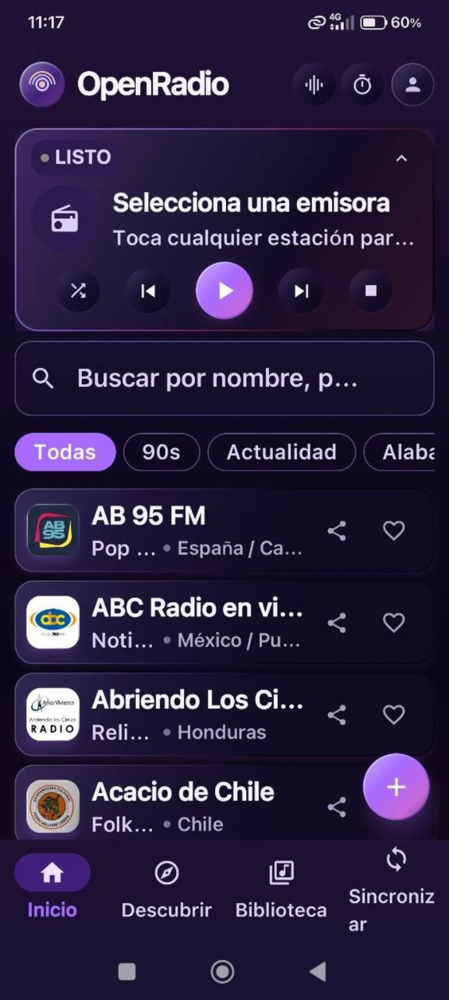
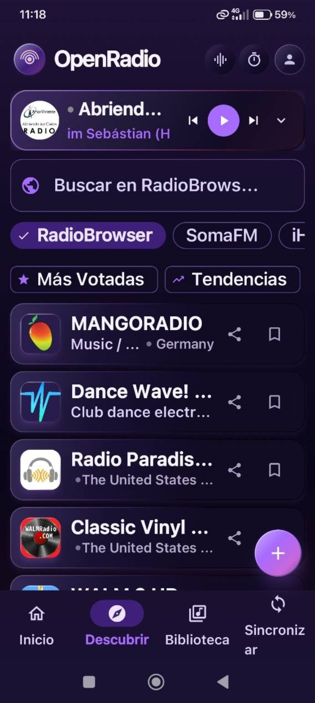
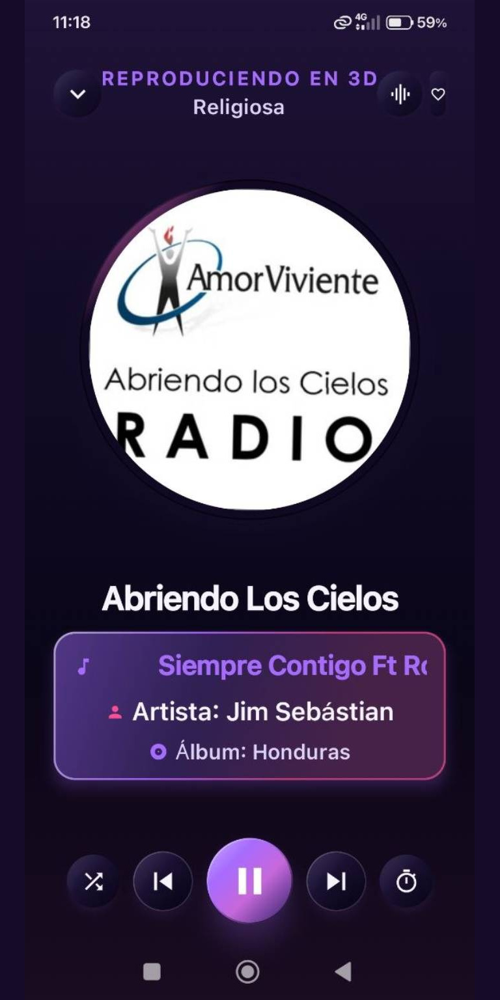
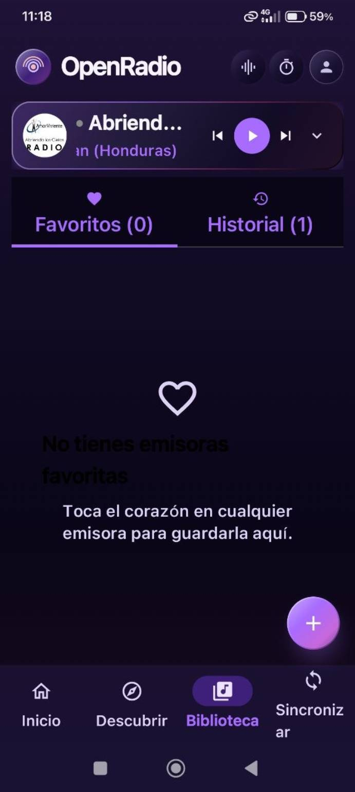
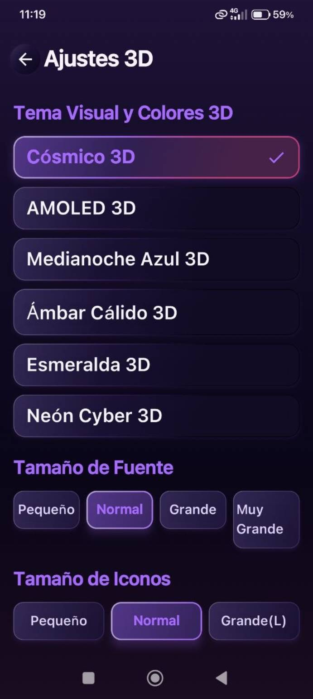

<div align="center">


# OpenRadio

**Radio por Internet para Android · Kotlin · Jetpack Compose · Media3**

[](https://github.com/latanvillegas/Radio-Escucha/actions/workflows/build-apk.yml)
[](https://github.com/latanvillegas/Radio-Escucha/releases/latest)
[](LICENSE)
[](app/build.gradle.kts)

[**Descargar APK firmado**](https://github.com/latanvillegas/Radio-Escucha/releases/latest) · [**Ver código**](app/src/main/java/com/example/) · [**Reportar un problema**](https://github.com/latanvillegas/Radio-Escucha/issues)

</div>

OpenRadio permite descubrir y escuchar **emisoras de radio por Internet** de todo el mundo, guardar favoritas, consultar el historial de reproducción y añadir emisoras mediante URL. Incluye reproducción en segundo plano, ecualizador, temporizador de apagado, una interfaz 3D configurable y una sesión multimedia compatible con Android Auto.

> **Conexión necesaria:** el audio se transmite desde servidores de emisoras; OpenRadio **no** sintoniza FM/AM mediante hardware ni ofrece descargas de música sin conexión. La caché local sirve para datos de emisoras y preferencias, no para reproducir emisiones desconectado.

## Capturas de pantalla

Capturas reales en español, tomadas de la aplicación, normalizadas a 768 × 1536 para los metadatos Fastlane.

<p align="center">
  
  
  
  
  
</p>

## Características verificadas

- **Radio en vivo:** reproducción de URLs de emisoras con Media3/ExoPlayer, incluyendo formatos compatibles como MP3, AAC y HLS; la disponibilidad y los formatos dependen del servidor.
- **Exploración y búsqueda:** RadioBrowser y otros directorios integrados; filtros por emisora, país y género.
- **Biblioteca local:** favoritas, historial de reproducción y emisoras personalizadas persistidas con Room.
- **Segundo plano y controles multimedia:** servicio `MediaLibraryService`, notificaciones de medios, controles externos y estructura de navegación para Android Auto (pendiente de pruebas en todos los vehículos).
- **Audio:** ecualizador y ajustes DSP en `RadioAudioDspEngine`, además de temporizador de apagado.
- **Personalización:** seis temas —Cósmico 3D, AMOLED 3D, Medianoche Azul 3D, Ámbar Cálido 3D, Esmeralda 3D y Neón Cyber 3D—, escalado de tipografía e iconos.
- **Ubicación opcional:** país inicial basado en la configuración regional del dispositivo. La consulta de país por IP se realiza solamente si el usuario la solicita y emplea HTTPS.

No se anuncian funciones de **grabación de emisoras** ni **alarma despertador**: no están implementadas como características disponibles en la versión actual.

## Instalar OpenRadio

1. Accede a [GitHub Releases](https://github.com/latanvillegas/Radio-Escucha/releases/latest).
2. Descarga `OpenRadio-vX.Y.Z.apk` (el APK de producción firmado). Puedes contrastar el archivo `.sha256` publicado en el mismo Release.
3. Instala el APK en Android 7.0 (API 24) o superior. Android puede solicitar que permitas instalaciones desde tu navegador o gestor de archivos.

**Actualizaciones:** utiliza los APK Release firmados con la misma clave. Un APK Debug con firma diferente no se actualiza directamente sobre un APK Release; haz una copia de tus datos antes de desinstalar una versión con firma distinta.

## Compilar desde el código fuente

**Entorno:** Android SDK con plataforma 35, JDK 17 y Android Studio compatible con Android Gradle Plugin 8.7.3. El proyecto utiliza **Gradle 8.9**.

```bash
git clone https://github.com/latanvillegas/Radio-Escucha.git
cd Radio-Escucha

# Linux/macOS: descargar Gradle 8.9 con el Wrapper y compilar.
./gradlew :app:assembleDebug --no-daemon

# Ejecutar pruebas unitarias JVM/Robolectric.
./gradlew :app:testDebugUnitTest --no-daemon
```

En Windows utiliza `gradlew.bat` con los mismos argumentos. El APK de depuración resultante se encuentra en `app/build/outputs/apk/debug/app-debug.apk`.

Para comprobar localmente la variante minificada sin publicar:

```bash
./gradlew :app:assembleRelease --no-daemon
```

> **Firma:** la compilación Release de distribución requiere el keystore privado del mantenedor; un `assembleRelease` local sin secretos de firma no sustituye al APK oficial firmado. El workflow de GitHub Actions gestiona la firma sin subir el keystore al repositorio.

## Arquitectura y stack

```text
app/src/main/java/com/example/
├── MainActivity.kt              Entrada Android y UI
├── ui/
│   ├── RadioApp.kt               Navegación y pantallas Compose
│   ├── RadioViewModel.kt         Estado de interfaz y casos de uso
│   ├── SettingsScreen.kt         Opciones de personalización
│   ├── components/               Componentes visuales reutilizables
│   └── theme/                    Temas y estilos
├── data/
│   ├── RadioRepository.kt        Repositorio de emisoras
│   ├── RadioBrowserApi.kt        Directorio externo
│   ├── MultiSourceRadioApi.kt    Proveedores de radio y metadatos
│   ├── RadioDatabase.kt          Room
│   ├── PlaybackHistory.kt        Historial local
│   └── ThemePreferences.kt       Preferencias DataStore
├── service/
│   └── PlaybackService.kt        Reproducción Media3/MediaLibraryService
└── util/
    ├── StreamFormatHelper.kt     Configuración de streams
    ├── RadioAudioDspEngine.kt    Ecualización y procesamiento de audio
    └── LogoImageLoader.kt        Carga de logotipos
```

Las versiones se declaran en [`gradle/libs.versions.toml`](gradle/libs.versions.toml), que es la fuente de verdad para el stack. Principales versiones del código actual:

| Componente | Versión declarada |
| --- | --- |
| Kotlin | `2.0.21` |
| Android Gradle Plugin | `8.7.3` |
| Compose BOM | `2024.10.01` |
| Media3 | `1.3.1` |
| Room | `2.7.0` |
| Retrofit | `2.12.0` |
| OkHttp | `4.10.0` |
| DataStore Preferences | `1.1.7` |
| Coil | `2.7.0` |
| Robolectric / Roborazzi | `4.16.1` / `1.59.0` |

La arquitectura utiliza Compose, `StateFlow`, un ViewModel, un repositorio, persistencia Room/DataStore y un servicio Media3. **No** se presume cumplimiento integral de Clean Architecture ni reproducibilidad binaria sin una evaluación independiente.

## Calidad y CI/CD

[GitHub Actions](.github/workflows/build-apk.yml) ejecuta para las solicitudes de cambio:

- Pruebas unitarias y de regresión.
- Auditoría automatizada de `releaseRuntimeClasspath` contra familias conocidas de SDK propietarios, junto con comprobaciones de política de red.
- Compilaciones Debug y Release con optimización R8.

Los lanzamientos `vMAJOR.MINOR.PATCH` generan un APK de producción firmado, verifican la firma con `apksigner` y publican un archivo SHA-256. **Una auditoría automática aprobada no acredita por sí sola todas las licencias de dependencias ni la reproducibilidad de la compilación.**

## Privacidad y seguridad

- El país inicial se obtiene localmente de la configuración regional. La detección por IP es **opcional** y se realiza por HTTPS.
- Las API configuradas y las rutas auxiliares de imágenes usan HTTPS; los logotipos sin HTTPS pueden sustituirse por un marcador.
- Algunos streams de terceros solo ofrecen HTTP. Por compatibilidad, el reproductor permite conexiones HTTP de emisoras arbitrarias. **La aplicación no es 100 % HTTPS.**
- Consultar directorios, carátulas y emisoras externas implica conexiones a servidores de terceros que pueden observar la IP y metadatos de solicitud.

Lee [la política de privacidad y red](docs/PRIVACY.md) y [la auditoría técnica y sus limitaciones](docs/SECURITY_PRIVACY_AUDIT.md).

## Distribución

| Canal | Situación |
| --- | --- |
| [GitHub Releases](https://github.com/latanvillegas/Radio-Escucha/releases/latest) | APK firmados disponibles |
| [Orion Store](https://github.com/RookieEnough/Orion-Data/issues/3187) | Solicitud de inclusión `#3187`, pendiente de aceptación |
| [IzzyOnDroid](https://codeberg.org/IzzyOnDroid/repodata/issues/930) | Solicitud de inclusión `#930`, pendiente de aceptación |
| F-Droid | No incorporado; requiere evaluación de dependencias, licencias y procedimiento de construcción |

Los metadatos para las tiendas se encuentran en [`fastlane/metadata/android/`](fastlane/metadata/android/). También puedes seguir los Releases con [Obtainium](https://github.com/ImranR98/Obtainium), usando la URL de este repositorio.

Documentación complementaria: [Distribución y firma](docs/DISTRIBUTION.md) · [Recursos para las tiendas](docs/STORE_ASSETS_AND_RELEASE.md) · [Auditoría y privacidad](docs/SECURITY_PRIVACY_AUDIT.md).

## Contribuir y licencia

Se aceptan incidencias y contribuciones mediante [Issues](https://github.com/latanvillegas/Radio-Escucha/issues) y Pull Requests. Antes de proponer cambios, revisa las pruebas, los efectos sobre emisoras HTTP y las limitaciones documentadas para las tiendas.

El **código original** del proyecto se distribuye bajo [licencia MIT](LICENSE). Los logotipos de emisoras, nombres comerciales, emisiones y otros recursos de terceros conservan sus respectivas titularidades y condiciones.

